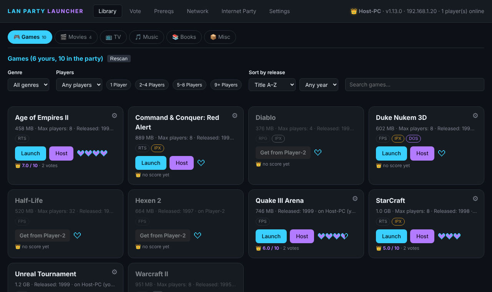
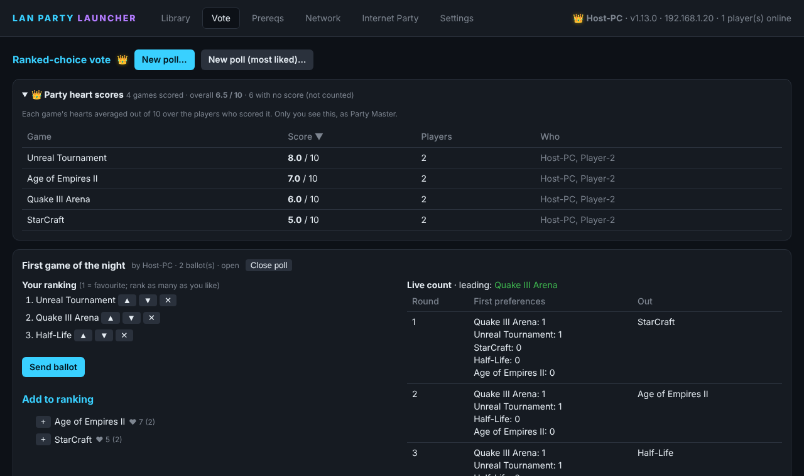
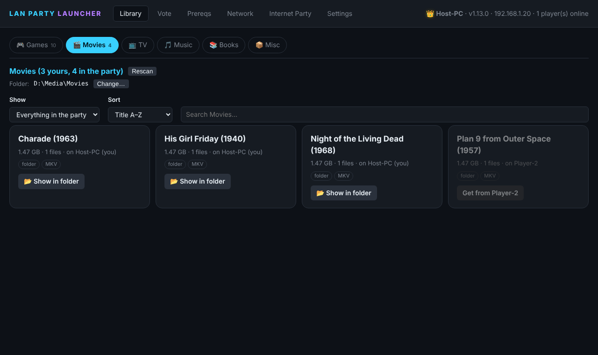
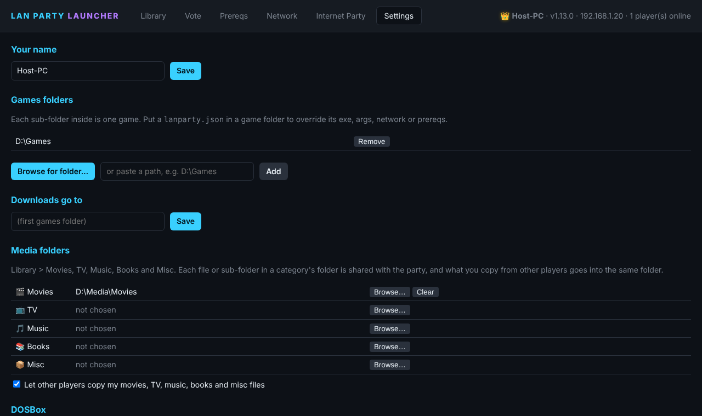

# LAN Party Launcher

One window for a LAN party: every player's games in one shared library, fast copying of games between PCs,
one-click host and join, a ranked-choice vote for what to play next, and an internet "LAN" over a VPN so old
games that only search the local network can still find each other.

Runs on Windows. Every PC at the party runs a copy; they find each other by themselves, with no server to set up.



## Features
- **Shared library.** Each player points the launcher at their games folder (one sub-folder per game). Every PC
  sees every game anyone has; games you lack show "Get from *player*".
- **Fast game copies.** A game copies from every player who has it at once, players who are still downloading
  share the parts they have, transfers are compressed (zstd/LZ4, level adjusted to the link), and every file is
  checked by SHA-256. While you are playing, copies slow down so your game doesn't lag.
- **Host and join in one click.** "Host for everyone" starts the game and shows everyone else a Join banner with
  the right address filled in. Per-game settings live in a small JSON file (see [docs/lan_json.md](docs/lan_json.md)).
- **Vote on what to play.** Ranked-choice (instant-runoff) polls with a live count on every PC, plus heart
  scores so the Party Master can see what people actually want to play.
- **Media sharing.** Movies, TV, Music, Books and Misc tabs share folders the same way as games.
- **Old games work.** IPXWrapper for Windows IPX games, DOSBox-X with IPX for DOS games, prerequisite installers
  (DirectX 9, Visual C++, .NET, DirectPlay, XNA, OpenAL, PhysX) and firewall rules in one click.
- **Internet party.** An encrypted n2n VPN with a short party code; LAN broadcasts cross it, so games that only
  look on the local network still see each other. Notes on tested games are in [docs/games.md](docs/games.md).
- **Self-updating.** When another player has a newer launcher, you can update from them with one click.

## Screenshots
| | |
|---|---|
|  |  |
| **Vote**: ranked-choice polls and heart scores | **Movies**: media folders shared like games |
|  | |
| **Settings**: your name, games and media folders | |

## Requirements
- Windows 10 or 11.
- Python 3.10 or newer (standard library only, no pip installs).
- For internet parties: the host forwards UDP port 7654 on their router (or a friend runs the supernode).

## Install
**Players:** download the release zip from the [Releases](../../releases) page, unzip it anywhere, and
double-click `run.bat`. The release includes the bundled programs listed below.

**From source:** clone this repository. It holds the source code only (under 1 MB). The bundled programs,
DOSBox-X and n2n in `lanparty\bin\` and the zstd/lz4 modules in `lanparty\vendor\` (about 60 MB), come in the
release zip; copy those two folders from it into `lanparty\`. Without `vendor` the launcher still works and copies
games uncompressed; without `bin` the internet-party VPN and the bundled DOSBox-X need to be supplied another way.

## Quick start
1. Double-click `run.bat`. It opens http://127.0.0.1:47801 in your browser.
2. **Settings → Browse for folder…** and pick the folder that holds your games (one sub-folder per game).
3. The first time, Windows asks to allow Python through the firewall; allow it on **private** networks, or use
   **Network → Open firewall** to add every rule at once.
4. Do the same on every PC. Copies on the same network find each other by themselves (UDP 47800, TCP 47801).

## Tabs
- **Library**: every game anyone has. Games you lack are greyed with "Get from *player*", which copies
  the game from every player who has it at once. "Host for everyone" starts the game and shows everyone a Join banner.
  While a game copies, its card shows live stats: speed, time left, each player it comes from, who copies it from
  you. Players who are still downloading a game share the parts they have (swarm), every file is checked by
  SHA-256, and while a game runs on your PC copies slow to the limit in **Settings → While I'm playing**.
- **Library > Movies / TV / Music / Books / Misc**: tabs next to Games for sharing media. Pick a folder for each
  category (the button on its tab, or Settings > Media folders); every file or sub-folder in it is shared with the
  party and copied the same way as games. Media is never run by the launcher: cards offer "Show in folder" only.
- **Vote**: ranked-choice (instant-runoff) polls. Rank as many games as you like; every PC shows the same live count.
- **Party Master** (Settings → "I am the Party Master", one player per party, shown with a 👑): only the Party
  Master starts polls ("New poll…" opens a list of every game in the party to tick), and everyone's screen switches
  to the Vote tab when a poll opens. The Party Master also sees each game's heart score out of 10 (averaged over
  the players who gave it hearts; games nobody scored aren't counted) on the cards and in a sortable table.
- **Prereqs**: DirectX 9.0c, VC++ 2005-2022, .NET 3.5/4.8, DirectPlay, XNA, OpenAL, PhysX. "Install all missing"
  needs one admin prompt. Installers bundled with your games are used first.
- **Network**: IPXWrapper for Windows IPX games, DOSBox IPX for DOS games, firewall rules, a check for VPN/virtual adapters.

## Updating the launcher
The version is in the top bar (e.g. `v1.1.0`) and in the Players table. When another player's launcher is newer,
a yellow bar says "Launcher v… is available from *player*" with an **Update** button. Nothing changes until you click it.
Then the launcher downloads that player's copy, checks every file against its SHA-256 list, backs up the files it
replaces into `backup\<date>_update\`, and restarts itself. During an internet party you stay connected: the VPN
keeps running through the restart and running games aren't interrupted (from v1.3.0; an older launcher still
leaves the party when it updates). Games, settings and `lanparty\bin\` are never touched.

During an internet party, games start through ForceBindIP so they use your VPN address (downloaded once from
r1ch.net; needs the Visual C++ 2015-2022 runtime). A game started that way has no internet. If a game needs the
internet or misbehaves, untick "Use the VPN address in internet parties" on its card.

If the launcher crashes or the PC restarts during an internet party, the Network tab offers **Rejoin last party**
(or **Host again** for the host, which keeps the same code) for 24 hours. **Leave party** forgets it.
A PC still on v0.1.0 doesn't have this feature yet, so it needs one manual copy of the files.

`python -m lanparty --make-release` writes `releases\LanPartyLauncher_v<version>.zip`. Peers fetch this file,
and it's rebuilt by itself when a file changes.

## Per-game overrides
Put `lanparty.json` in a game folder:
```json
{"title": "Red Alert", "exe": "RA95.EXE", "network": "ipx", "args": "", "join_args": "", "prereqs": ["directplay"]}
```
`join_args`/`host_args` may use `{host_ip}`. The shared starter list is `data\known_games.json`.

## Test
`python tests\smoke_test.py` starts two launchers on this PC and checks discovery, library merge, the vote,
a game download, the path-traversal guard and a launcher update from a newer copy. It should end with `ALL_PASS`.

## Command-line options
`python -m lanparty --port 47801 --name Player --folder D:\Games --peer 192.168.1.20:47801 --no-browser`

## Project layout
| Path | What it is |
|---|---|
| `lanparty/` | The launcher (Python). `server.py` serves the web interface and the peer API. |
| `lanparty/web/` | The interface (HTML, CSS, JavaScript; no build step). |
| `data/known_games.json` | Starter list of games: ids, aliases, network type, host/join arguments. |
| `docs/` | Per-game settings format, tested games and their network notes. |
| `tests/` | `smoke_test.py` and unit tests; run each with `python tests\<name>.py`. |
| `tools/` | `lanprobe.py`, a tester for what game-style discovery packets cross the network. |

## License
GNU General Public License v3.0, see [LICENSE](LICENSE). Bundled third-party programs keep their own licenses,
listed in [THIRD_PARTY_NOTICES.md](THIRD_PARTY_NOTICES.md).
